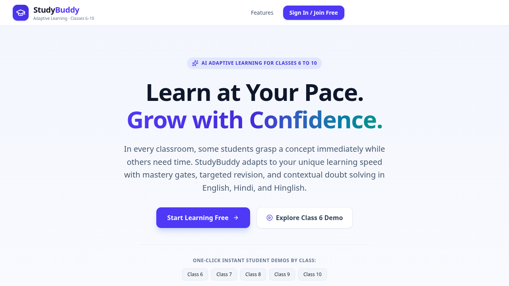
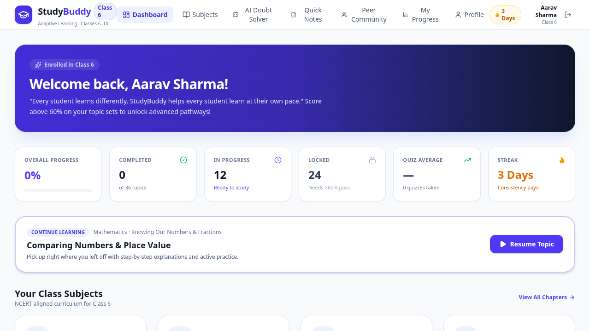
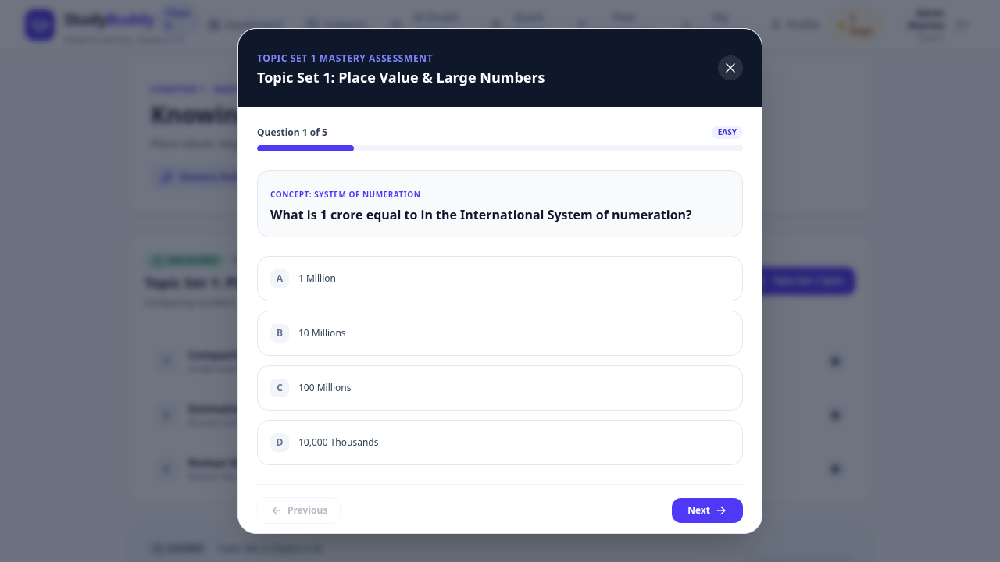
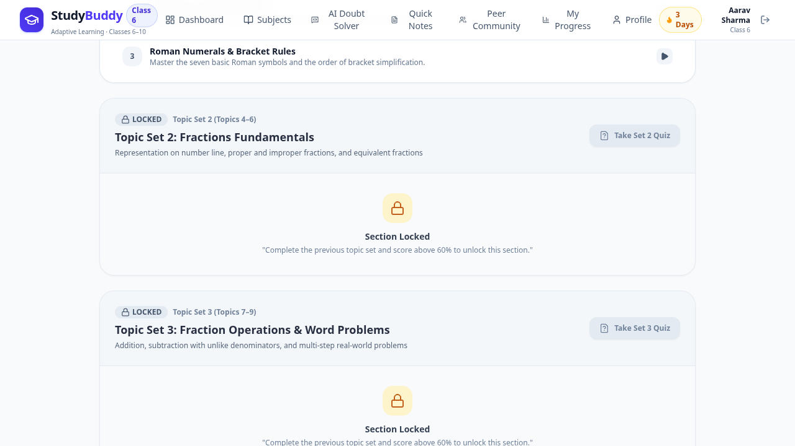
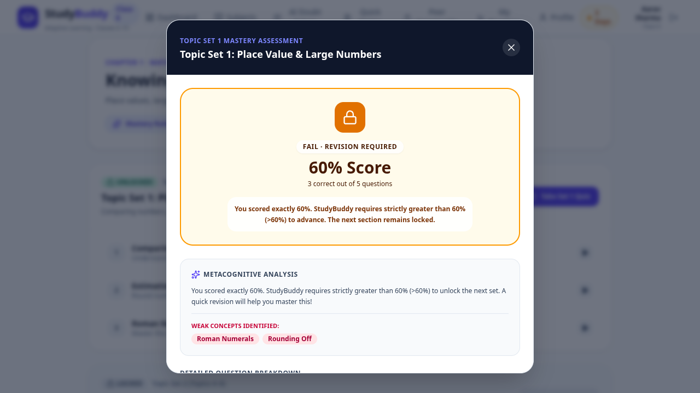

<div align="center">
  
  <h1>StudyBuddy — AI-Powered Adaptive Learning</h1>
  <p><strong>Learn at your pace. Grow with confidence.</strong></p>
  <p>An adaptive learning platform for school students in Classes 6–10, combining personalized topic progression, AI-powered doubt solving, and performance insights.</p>
  <p>
    
    
    
    
  </p>
</div>

## Overview

StudyBuddy is designed to make learning more personal, understandable, and outcome-oriented. Instead of moving every learner through the same path at the same pace, it breaks chapters into smaller topics, checks understanding through assessments, and uses performance to guide what a student should learn next.

The platform also includes a multilingual AI doubt solver that explains concepts in English, Hindi, or Hinglish with grade-appropriate, step-by-step guidance.

## Key Features

- **Adaptive topic learning:** Organizes chapter content into smaller, manageable learning units.
- **Mastery-based progression:** A score strictly above 60% unlocks the next topic set; a score of 60% or below keeps it locked and encourages revision.
- **AI doubt solver:** Uses Google Gemini to provide contextual, step-by-step explanations in English, Hindi, and Hinglish.
- **Interactive quizzes:** Checks understanding through topic-based assessments.
- **Performance analytics:** Helps learners track progress, completion, and areas that need more attention.
- **Learning resources:** Includes chapter learning views and short notes to support revision.
- **Student community:** Provides a space for learners to discuss questions and support peer learning.
- **Student profile and progress:** Keeps learning activity and progress connected to the student experience.

## Product Preview

| Landing Page | Student Dashboard |
|:--:|:--:|
|  |  |

| Interactive Quiz | Mastery-Based Progression |
|:--:|:--:|
|  |  |

| Quiz Performance |
|:--:|
|  |

## How Mastery-Based Progression Works

1. A student studies a topic within a chapter.
2. The student completes the assessment for the topic set.
3. StudyBuddy evaluates the result against the 60% mastery threshold.
4. **Above 60%:** the next topic set is unlocked.
5. **60% or below:** the next set remains locked while the student revises and strengthens their understanding.

This approach encourages conceptual understanding before students move ahead.

## Technology Stack

| Layer | Technologies |
|---|---|
| Frontend | React 19, TypeScript, Vite |
| Styling & UI | Tailwind CSS 4, Lucide React, Motion |
| Backend | Node.js, Express, TypeScript (tsx) |
| AI | Google Gemini API via `@google/genai` |
| Authentication & Database | Firebase Authentication, Cloud Firestore |
| Build & Development | Vite, npm |

## Getting Started

### Prerequisites

- Node.js (a current LTS release is recommended)
- npm
- A Google Gemini API key
- A Firebase project configured for the application

### 1. Clone the repository

```bash
git clone https://github.com/<your-username>/<your-repository-name>.git
cd <your-repository-name>
```

### 2. Install dependencies

```bash
npm install
```

### 3. Configure environment variables

Create a `.env.local` file in the project root and add your Gemini API key:

```env
GEMINI_API_KEY=your_gemini_api_key
```

The server also accepts `PORT` (defaults to `3000`). Do not commit `.env.local` or expose API keys in frontend code. Keep secrets private and configure Firebase credentials/settings for your own Firebase project before running the app.

### 4. Run the development server

```bash
npm run dev
```

Open the local URL printed in your terminal (typically `http://localhost:3000`).

### 5. Create a production build

```bash
npm run build
```

To preview the production build locally:

```bash
npm run preview
```

## Environment & Security Notes

- `GEMINI_API_KEY` is read by the server and should remain a server-side secret.
- Never commit `.env.local`, private keys, service-account files, or other credentials.
- Review Firebase Authentication and Firestore security rules and configure them for your deployment before using real student data.
- Replace any project-specific Firebase configuration with your own Firebase project configuration where required.

## Team

Built with ❤️ by:

| Team Member | Role |
|---|---|
| **Shivansh Pandey** | Project Team Member |
| **Amogh Mishra** | Project Team Member |
| **Krishna Agarwal** | Project Team Member |

## Project Vision

Our vision is to make personalized, supportive, and mastery-driven learning accessible to every student—regardless of their learning pace or preferred language.

---

<div align="center">
  <strong>StudyBuddy — Every student deserves a learning path of their own.</strong>
</div>
